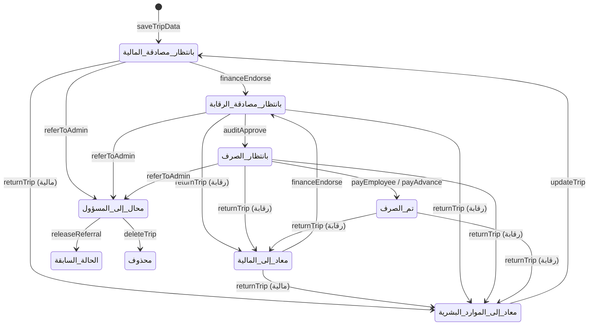

# دورة العمل والضوابط الرقابية

## الحالات

الحالة تُخزَّن **لكل موفد** في عمود «حالة الموفد»، أما «حالة الطلب» للإيفاد فتُحسب بالتجميع (`syncTripStatus_`) بعد كل إجراء.

| الحالة | معناها |
|---|---|
| بانتظار مصادقة المالية | بعد الإصدار أو بعد التعديل |
| بانتظار مصادقة الرقابة | بعد مصادقة المالية |
| بانتظار الصرف | بعد مصادقة الرقابة |
| تم الصرف | صُرفت المستحقات كاملة ولا سلفة مفتوحة |
| معاد إلى الموارد البشرية / المالية | مخالفة تتطلب تصحيحاً |
| محال إلى المسؤول | بنود الإيفاد مجمَّدة حتى بتّ المسؤول |
| محذوف | حذف منطقي بقرار المسؤول |

أولوية العرض عند التجميع (من الأعلى): محذوف ← محال إلى المسؤول ← معاد إلى الموارد البشرية ← معاد إلى المالية ← تم الصرف (إن كان كل الموفدين كذلك) ← بانتظار مصادقة المالية ← بانتظار مصادقة الرقابة ← بانتظار الصرف.

## مخطط الانتقالات (لكل موفد)

ملاحظات: `referToAdmin` تُحيل الإيفاد كله من أي حالة غير «محذوف» أو «محال» (بما فيها المعادة)، شرط ألا يكون قد صُرف منه شيء. `updateTrip` يعيد **كل** موفدي الإيفاد إلى «بانتظار مصادقة المالية» (لأن بيانات الإيفاد المشتركة تغيّرت). `releaseReferral` يعيد كل موفد إلى حالته قبل الإحالة تماماً (عمود «الحالة قبل الإحالة») فلا يُتجاوَز أي اعتماد؛ فإن لم يوجد سجل سابق يبدأ من أول مصادقة.

## الضوابط المبرمجة

| # | الضابط | أين يُطبَّق |
|---|---|---|
| 1 | **لا صرف قبل مصادقة الرقابة** على بند الموفد (مخصصات أو سلفة) | `payEmployee`، `payAdvance`: يشترط حالة «بانتظار الصرف» |
| 2 | **رقم قيد الصرف إلزامي** عند كل صرف | `voucher_` |
| 3 | **الصرف المبكر** (قبل تاريخ العودة) يتطلب رقم موافقة إدارة الشركة | `payEmployee` (الوسيط `earlyApproval`) |
| 4 | **غرض الإيفاد إلزامي** (الضابط 2 في ضوابط الإيفادات) | `prepareTrip_` |
| 5 | **مصادقة المالية تسبق الرقابة** | `auditApprove` يشترط «بانتظار مصادقة الرقابة» |
| 6 | **الإعادة تتطلب نوع المخالفة ووصفها**، وجهتها `hr` أو `finance` فقط | `returnTrip` |
| 7 | **صلاحيات الإعادة:** الرقابة تعيد بنداً في مرحلة المصادقة أو الصرف أو بعد الصرف؛ المالية تعيد إلى الموارد البشرية فقط، ومن مرحلتها | `returnTrip` |
| 8 | **تعديل الإيفاد لا يكون إلا بعد إعادة أحد موفديه** إلى الموارد البشرية، ويتطلب **سبباً مكتوباً** | `updateTrip` |
| 9 | **ما صُرف لا يُمحى بل يُسوّى:** تعديل ينقص المستحق عمّا صُرف، أو حذف موفد صُرف له، ينشئ تسوية «استرداد» بدل الكتابة فوق المصروف | `updateTrip`، `addAdjustment_` |
| 10 | **السلفة المصروفة لا تُغيَّر ولا يُحذف صاحبها** | `updateTrip` |
| 11 | **لا إحالة ولا حذف لإيفاد صُرف جزء منه** | `referToAdmin`، `deleteTrip` (`paidNames_`) |
| 12 | **من أحال الإيفاد لا يبتّ فيه** ويلزم سبب مكتوب للقرار | `adminCase_` |
| 13 | **الحذف منطقي:** يبقى الإيفاد في الشيت مع من حذفه ومتى ولماذا، ولا يُعاد استخدام رقمه | `deleteTrip`، `saveTripData` (فحص التكرار يشمل المحذوف) |
| 14 | **عدم تداخل إيفادات الموفد الواحد زمنياً**؛ والإيفاد الثاني في اليوم نفسه بعد العودة إلى النجف يُوسَم «إيفاد ثانٍ» (الضابط 9) | `checkOverlaps_` |
| 15 | **منع تكرار رقم الإيفاد** بعد توحيد الأرقام الهندية والمسافات | `saveTripData`، `checkDuplicateID` |
| 16 | **تسوية السلفة بالفواتير:** الفرق استرداد (بوصل قبض) أو مستحق إضافي | `settleAdvance` |
| 17 | **إغلاق التسوية** برقم وصل قبض (للاسترداد) أو قيد صرف (للمستحق الإضافي) | `settleAdjustment` |
| 18 | **مسار تدقيق كامل:** كل إجراء يُسجَّل بالوقت والبريد والدور | `appendLog_` |
| 20 | **متابعة السلف المتأخرة (كشفي لا منعي):** سلفة «مصروفة» لم تُسوَّ بعد **10 أيام** من تاريخ العودة تظهر للموارد البشرية (تنبيه ومرشح وشارة ووسم) وللمالية (وسم على بند التسوية) إلى أن تُسوّى | الواجهة: `advanceAging`، `overdueAdvances` |
| 19 | **فصل المهام بلا استثناء** لكل نسخة من الإيفاد ولكل موفد: المُدخِل (أو المعدِّل) ≠ مصادق المالية ≠ المدقق ≠ المُدخِل؛ والصارف ≠ المُدخِل و≠ المدقق، ويجوز أن يكون مصادق المالية. الأدوار المتعددة للشخص الواحد مسموحة بشرط ألا يكرر دورين على الإيفاد نفسه | `assertSeparation_` في `financeEndorse` و`auditApprove` و`payEmployee` و`payAdvance` |

## التسويات

تُنشأ بمعرّف تسلسلي `ADJ-n` بحالة «مفتوحة» (`addAdjustment_`) من مصدرين: «تعديل» (بعد صرف) أو «سلفة». عند إغلاق تسوية «استرداد» من مصدر «تعديل» يُنقَص «المصروف» الفعلي للموفد بقيمتها. تسوية السلفة تنقل حالة السلفة إلى «مُسوّاة».

## ما لا تضبطه الشيفرة

الضوابط 1–18 تتحقق من **الدور والحالة**، والضابط 19 يفصل المهام بحسب **البريد الإلكتروني**: من يملك حسابين مختلفين يتجاوزه، ومن يملك صلاحية تحرير الملف يعدّل الشيتات مباشرة متجاوزاً كل الضوابط (الملاحظة 5). انظر `known-observations.md`.
